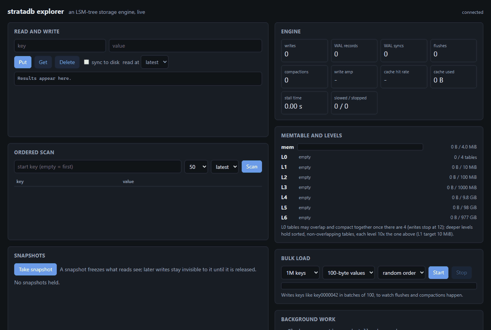
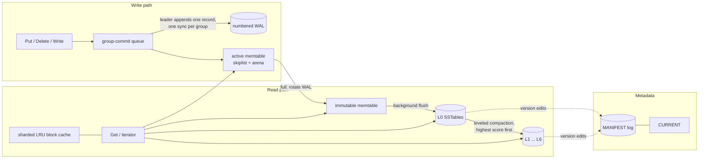

# stratadb

stratadb is an embedded key-value storage engine in C++20 built on the
log-structured merge tree design used by LevelDB and RocksDB: a write-ahead log
and a skiplist memtable in front of immutable, leveled SSTables with bloom
filters and a block cache. The hard parts are not the data structures on their
own. They are the rules that hold them together: an acknowledged write must
survive `kill -9` at any instant, including in the middle of a flush or a
compaction; compaction must never resurrect a deleted key or drop a version a
snapshot can still see; and a reader must keep every file it uses alive while a
background thread deletes the files compaction made obsolete. This repository
tests those rules directly, with differential tests against `std::map`, a
kill-and-recover campaign of hundreds of cycles, and a comparison against
LevelDB on the same machine.

**Website:** [arnavlifelesscoder.github.io/stratadb](https://arnavlifelesscoder.github.io/stratadb/),
the demo, durability totals and LevelDB comparison on one page, read from the
committed results.

**Demo:** [watch the explorer](docs/explorer-demo.gif), a local web UI over the
engine, read a key at a snapshot while it is overwritten, then load 1M keys and
show the flushes, compactions and write stalls as they happen
([how to run it](docs/explorer.md)).



## Results

Against LevelDB 1.23 built from source with matching settings (4 MiB memtable,
4 KiB blocks, 64 MiB block cache, 10 bloom bits per key, no compression,
checksums verified on read), single-threaded, 16-byte keys and 100-byte values,
10M keys. Median of 5 runs with min-max in brackets, on one Windows laptop
(Ryzen 9 8940HX, 15 GiB RAM, NVMe). Source: `results/m8/bench/bench-summary.md`;
settings and method: [docs/benchmarks.md](docs/benchmarks.md).

| Workload | stratadb ops/s | p99 us | LevelDB ops/s | p99 us |
|---|---|---|---|---|
| fillseq | 47K [44K-58K] | 27.4 | 105K [101K-118K] | 18.3 |
| fillrandom | 20K [6K-22K] | 41.9 | 42K [41K-47K] | 23.2 |
| readrandom | 99K [88K-107K] | 20.2 | 68K [66K-92K] | 29.0 |
| readseq | 1,170K [1,050K-1,346K] | - | 3,110K [2,638K-3,596K] | - |
| YCSB A (50% update) | 67K [52K-78K] | 29.0 | 73K [68K-84K] | 33.5 |
| YCSB B (5% update) | 114K [93K-123K] | 24.8 | 99K [92K-125K] | 25.1 |
| YCSB C (read only) | 113K [99K-127K] | 23.3 | 109K [97K-120K] | 20.3 |
| YCSB D (read latest) | 187K [137K-204K] | 21.2 | 161K [148K-216K] | 21.6 |
| YCSB E (short scans) | 13K [11K-15K] | 260.5 | 26K [26K-29K] | 76.9 |
| YCSB F (read-modify-write) | 36K [34K-44K] | 46.0 | 57K [53K-70K] | 41.3 |
| missing keys, bloom 10 bits | 700K [655K-774K] | 6.8 | 221K [160K-290K] | 17.1 |
| missing keys, no bloom | 101K [48K-109K] | 18.1 | 117K [95K-132K] | 36.6 |

| | stratadb | LevelDB |
|---|---|---|
| Write amplification, fillrandom (OS bytes / user bytes, end of load) | 10.36 | 9.50 |
| Write amplification, fillseq | 4.90 | 2.19 |
| Data blocks read per missing-key lookup, bloom 10 / no bloom | 0.014 / 1.922 | not exposed |

Point reads, read-heavy YCSB and missing-key lookups are on par with or faster
than LevelDB. Loads are about half as fast and scans two to three times slower;
sequential loads write twice as much because LevelDB moves non-overlapping
tables down a level without rewriting them and this engine does not. The
reasons are in [docs/benchmarks.md](docs/benchmarks.md#reading-the-results).

Durability: across the recorded crash campaigns (`results/m6`, `results/m7`,
`results/m8`), sync-mode kill cycles never lost an acknowledged write; the final
engine commit passed 200 sync and 200 async cycles in debug and 50 of each
under ASan, plus 500 async cycles in debug before the last compaction change.

## Architecture



A read captures the active memtable, the immutable memtable and the current
`Version` (the reference-counted file list) under one lock, then reads without
locks. Point lookups go memtable, immutable memtable, L0 newest first, then one
table per deeper level (key-range check, bloom filter, index, data block).
Iterators merge the same sources lazily. A snapshot is a sequence number plus
the read view it pins; an obsolete table is deleted only after no version,
iterator or snapshot refers to it.

The on-disk table layout is drawn in [docs/sstable.md](docs/sstable.md). Other
design notes: [memtable and WAL](docs/memtable-wal.md),
[flush and recovery](docs/flush-recovery.md),
[compaction and snapshots](docs/compaction-snapshots.md),
[block cache, group commit and stalls](docs/write-path.md),
[crash testing](docs/crash-testing.md).

## Building and running

Requirements: CMake 3.20+, Ninja, Python 3.11+, and either Visual Studio 2022
(MSVC, Windows x64) or GCC 12+ / Clang 15+ (Linux x86-64). GoogleTest, Google
Benchmark and LevelDB are fetched by CMake at pinned commits.

```sh
cmake --preset debug && cmake --build --preset debug
ctest --preset debug
cmake --preset asan && cmake --build --preset asan && ctest --preset asan
cmake --preset tsan && cmake --build --preset tsan && ctest --preset tsan   # Linux only
```

On Windows run these from an x64 Visual Studio developer shell, or use
`scripts\build.ps1 -Preset debug`, which sets one up. `--seed=N` reruns the
randomized tests with a given seed; `--quick` shortens the long differential
runs during development. See [docs/building.md](docs/building.md).

Crash campaign (500 kill cycles per mode):

```sh
python python/crash_test.py --executable build/debug/lsm_crash_writer --mode sync --cycles 500 --work build/crash/sync --output build/crash/sync.json
python python/crash_test.py --executable build/debug/lsm_crash_writer --mode async --cycles 500 --work build/crash/async --output build/crash/async.json
```

Explorer, a local web UI that shows the engine working (reads and writes,
scans, snapshots, a bulk loader, and live memtable, level, compaction and stall
statistics); see [docs/explorer.md](docs/explorer.md):

```sh
cmake --preset explorer && cmake --build --preset explorer
build/explorer/lsm_server --db=explorer-db --port=8080   # then open http://127.0.0.1:8080
```

Benchmarks (release build, builds LevelDB 1.23 from source):

```sh
cmake --preset release && cmake --build --preset release
python bench/run_benchmarks.py --work build/bench --output build/bench/raw.json
python bench/summarize.py build/bench/raw.json --prefix build/bench/summary
```

## Design decisions

- **Chose a numbered WAL per memtable over one long log**, because recovery then
  only replays the logs the manifest names, and an obsolete log can be deleted
  as soon as its memtable's table is committed. The manifest records the
  previous and current WAL and the table being flushed, so a crash at any point
  of a flush either replays the old log or finds the table published.
- **Chose memory-mapped table files with a copying block cache over `pread`**,
  because the OS page cache already holds hot files and a mapping avoids a
  system call per block. The cache stores copies that were CRC-checked once on
  the way in, so cache hits skip both the copy and the CRC.
- **Chose scoring every level, L0 included, over always compacting L0 first.**
  The first version compacted L0 whenever it reached its trigger. Under a steady
  write load that starved L1, which grew to ten times its target, and every L0
  compaction then rewrote most of it. Scoring L0 by table count against the
  others, as LevelDB does, keeps L1 near its target; flushing a waiting
  memtable in the middle of a long compaction keeps writers from queueing
  behind it.
- **Chose leader-based group commit over a dedicated log thread**, because the
  first writer in the queue can do the append and sync itself while later
  writers wait, which needs no extra thread or hand-off, and every writer still
  learns its own result. 16 threads issuing 1,600 sync writes needed 167 syncs
  in the recorded run (`results/m7/verification/test-debug.log`).
- **Chose streaming iterators that pin a `Version` over materializing a scan**,
  because an early version that copied the whole visible database per iterator
  made a 50-key scan cost as much as a full dump. Pinning the `Version` and both
  memtables keeps every file the iterator may still open alive; deletion waits
  for the last reference.
- **Chose a separate kill harness that checks prefixes over checking only the
  final value of each key**, because a torn batch or a resurrected delete can
  leave every individual value plausible while the database as a whole matches
  no point in its history.

## Testing

- **Differential tests against `std::map`**: 10,000 seeded op streams of puts,
  deletes and batches with close/reopen; random snapshots whose reads and
  iterators must match the map as it was when they were taken; random merges and
  compactions checked at every supported snapshot; forward, reverse and
  direction-changing iteration. Every randomized test prints its seed and takes
  `--seed=N`.
- **Format and corruption**: every byte of a table flipped and every prefix
  truncated must be rejected; WAL and manifest recovery are tested at every
  truncation point, with zero-filled tails, and with damage in the middle (which
  must fail rather than silently truncate).
- **Fault injection**: short writes, failed syncs, failed renames and failed
  deletes through an injectable file interface; a failure is sticky and never
  acknowledges an unsynced write.
- **Concurrency**: readers and snapshots during flushes and compactions, an
  iterator stepping slowly while compaction deletes other tables, 16 sync writers
  sharing group commits. These run under ASan and, on Linux CI, TSan.
- **Crash testing**: `python/crash_test.py` kills a writer with `SIGKILL` /
  `TerminateProcess` at random times, about 15% of them during recovery, and
  requires the recovered database to equal some prefix of the logged history
  that includes every acknowledged sync write. A deliberately broken WAL replay
  fails it on the first cycle. Results are in `results/m6`, `results/m7` and
  `results/m8`.
- **CI**: debug and ASan on Windows (MSVC) and Linux (GCC), TSan on Linux,
  clang-format, clang-tidy and ruff, plus a 40-cycle crash campaign per job.

## Limitations

- A process kill keeps the OS page cache, so the crash campaign cannot show
  that a missing `fsync` loses data on power loss. Sync ordering is covered by
  fault-injection tests instead; a power-loss harness (VM or fault-injecting
  filesystem) is out of scope.
- One background thread does all flushes and compactions, a compaction's output
  is not split by grandparent overlap, and a table that overlaps nothing below
  is still rewritten instead of moved down a level. Loads run at about half of
  LevelDB's rate, and sequential loads write about twice as much.
- Scans pay for per-entry validation and virtual calls through the iterator
  stack, and are two to three times slower than LevelDB's.
- No compression, column families, transactions, TTL or replication.
- The benchmark machine is a Windows laptop: the OS file cache could not be
  dropped between runs, CPU boost stayed on, and every data set fits in RAM, so
  the read numbers are in-memory numbers.
- Windows has no directory `fsync`; publication there relies on
  `MoveFileExW(MOVEFILE_WRITE_THROUGH)` and NTFS metadata journaling.
