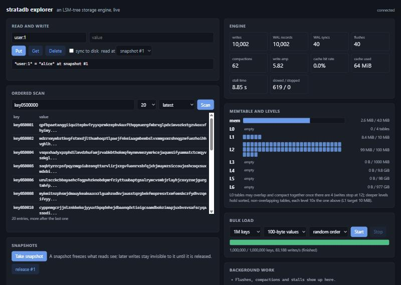

# Explorer

`explorer/` is a local web UI for one database: a small HTTP server
(`lsm_server`, built on cpp-httplib) and a single page with no build step.



The page shows:

* **Read and write**: put, get and delete, optionally synced to disk, and gets
  at any held snapshot.
* **Ordered scan**: a page of keys from a start key, at the latest state or at a
  snapshot.
* **Snapshots**: take and release them; a snapshot keeps showing the values it
  saw while later writes go on.
* **Engine**: write calls, WAL records and syncs (group commit), flushes,
  compactions, write amplification, block cache hit rate and use, and stall
  time with slowed and stopped writes.
* **Memtable and levels**: memtable fill, L0 table count against its trigger,
  and each deeper level's size against its target, one square per table.
* **Bulk load**: writes 100K to 5M generated keys in batches of 100, in random
  or key order, so flushes, compactions and stalls can be watched as they
  happen.
* **Background work**: a running log of flushes, compactions (with the level
  changes they made) and write slowdowns or stops, derived from the counters.

## Running it

```sh
cmake --preset explorer
cmake --build --preset explorer
build/explorer/lsm_server --db=explorer-db --port=8080
```

Then open `http://127.0.0.1:8080`. The server listens on 127.0.0.1 only and
serves the page from `explorer/web/` (override with `--web=DIR`).
`--memtable_bytes=N` makes the memtable smaller so background work starts
sooner. Ctrl+C stops the bulk loader, releases held snapshots and closes the
database cleanly.

## API

All responses are JSON; errors are `{"error": "..."}` with a 4xx or 5xx status.

| Method | Path | Parameters |
|---|---|---|
| GET | `/api/stats` | none |
| GET | `/api/get` | `key`, optional `snapshot` |
| POST | `/api/put` | `key`, `value`, optional `sync=true` |
| POST | `/api/delete` | `key`, optional `sync=true` |
| GET | `/api/scan` | optional `start`, `limit` (1 to 1000, default 50), `snapshot` |
| POST | `/api/snapshot` | none; returns `{"id": N}` |
| POST | `/api/snapshot/release` | `id` |
| POST | `/api/load` | `count`, `value_size`, `order=random\|sequential`, `prefix` |
| POST | `/api/load/stop` | none |

Keys and values are arbitrary bytes. JSON output escapes control characters and
bytes at or above 0x80 as `\u00XX`, so non-ASCII text shows up byte by byte.

## Tests

`tests/test_server.py` starts the built server on a free port with a fresh
database and checks put/get/delete (including escaping), snapshot isolation and
release, ordered and paged scans, the bulk loader and its progress counters,
and that the page is served. CI runs it in the `explorer` job:

```sh
LSM_SERVER=build/explorer/lsm_server python -m pytest -q tests/test_server.py
```

The per-level bytes and the flush and compaction counters the page uses come
from `DB::GetStats()` and are covered by
`WritePathTest.StatsCountFlushesCompactionsAndBytesPerLevel`.
